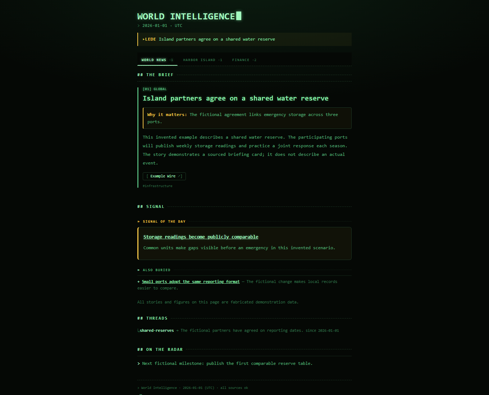
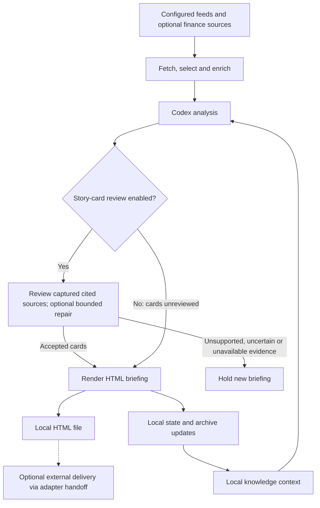

# World Intel

Turn configured news feeds and optional finance sources into a source-linked
HTML briefing you can read locally. World Intel is for technically comfortable
readers who want to choose their coverage, inspect model-assisted summaries,
and follow the reporting behind each story.

**Accuracy:** summaries can contain factual errors. Optional source review covers
full story cards, not Signals, Radar or every other section. Check important
claims against the original reporting. [Read the limitations](#accuracy-privacy-and-limitations).

[See the briefing](#see-the-briefing) · [Try the demo](#quickstart-try-the-offline-demo) ·
[Generate live](#generate-a-live-briefing) · [Choose coverage](#choose-your-coverage) ·
[How it works](#how-it-works) · [Documentation](#documentation-and-contributing)

## See the briefing



*Fabricated offline demo: all stories, figures, source labels and links are
invented, including the Harbor desk. Screenshot created 2026-10-29; this date
records the preview's creation, not news freshness or live coverage.*

The briefing combines headlines, explanations of why stories matter, article
summaries and source links. Coverage profiles choose the news desks and finance
inputs. The demo shows the layout with bundled fictional material; generate it
locally to explore the HTML.

## Quickstart: try the offline demo

### Prerequisites

Use Git and Python **3.11 or 3.12** on Windows or Linux. Installation needs
internet access; running the installed demo needs no network, API keys or model
subscription.

On Ubuntu/Debian, install the matching Python venv package first (for example,
`python3.12-venv` for Python 3.12).

### Install and run

Windows PowerShell:

```powershell
git clone https://github.com/lilnavin/world-intel-alpha.git
cd world-intel-alpha
python -m venv .venv
.venv/Scripts/python.exe -m pip install --require-hashes -r requirements.lock
.venv/Scripts/python.exe -m pip install --no-deps --no-build-isolation .
.venv/Scripts/world-intel.exe demo --out out/demo
```

Linux:

```bash
git clone https://github.com/lilnavin/world-intel-alpha.git
cd world-intel-alpha
python3 -m venv .venv
.venv/bin/python -m pip install --require-hashes -r requirements.lock
.venv/bin/python -m pip install --no-deps --no-build-isolation .
source .venv/bin/activate
world-intel demo --out out/demo
```

Dependencies, including build dependencies, are pinned and hash-locked. For
development checks and tests, see [Contributing](CONTRIBUTING.md).

### Open your briefing

The command prints the created file's absolute path. Open
`out/demo/world-intel-demo.html` in your browser, or use:

```powershell
# Windows PowerShell
Start-Process out/demo/world-intel-demo.html
```

```bash
# Linux desktop
xdg-open out/demo/world-intel-demo.html
```

The demo refuses to overwrite an existing file. To run it again, choose a fresh
output directory, such as `out/demo-2`.

## Generate a live briefing

### What you need

In addition to the installation above, live generation needs network access and
an **installed, authenticated Codex CLI** with model access. Codex is the supported
analysis engine. The `minimal` profile needs no source API credentials; optional
providers have their own setup requirements below.

### Create your configuration

Keep your profile, runtime data and credentials **outside every Git checkout**.
The examples below use your home directory, assuming it is not itself inside a
Git repository. Choose another private location if needed. From the installed
checkout (with the environment activated on Linux), create a starting profile:

```powershell
# Windows PowerShell
.venv/Scripts/world-intel.exe init --profile minimal --out "$env:USERPROFILE/worldintel.yaml"
```

```bash
# Linux
world-intel init --profile minimal --out "$HOME/worldintel.yaml"
```

`init` refuses to overwrite an existing profile. Read and edit the file before
running it: it controls sources, local paths and editorial instructions. Set
`delivery.adapter: file` for a local file, or keep `stdout` for a path on standard
output. Both leave transport to you.

For live use, enable both settings in the profile's existing `analysis` section
(create that section if absent):

```yaml
analysis:
  source_review_enabled: true
  source_review_repair_enabled: true
```

This opt-in check consumes additional model access and may withhold a briefing.
It does not review every section. [Review scope and behavior](#what-source-review-checks).

### Validate and run

Windows PowerShell:

```powershell
.venv/Scripts/world-intel.exe validate --config "$env:USERPROFILE/worldintel.yaml" --strict
.venv/Scripts/world-intel.exe doctor --config "$env:USERPROFILE/worldintel.yaml"
.venv/Scripts/world-intel.exe run --config "$env:USERPROFILE/worldintel.yaml" --dry --force
```

Linux:

```bash
world-intel validate --config "$HOME/worldintel.yaml" --strict
world-intel doctor --config "$HOME/worldintel.yaml"
world-intel run --config "$HOME/worldintel.yaml" --dry --force
```

`doctor` checks local prerequisites; it does **not** verify Codex login.
`--dry` still fetches sources and invokes Codex, using temporary working data
without publishing a briefing or updating persistent knowledge state. It does
not leave a viewable HTML briefing. `run --offline` is unsupported.

When ready to save a live result, rerun the same `run` command without `--dry`.
Normal runs save `brief-YYYY-MM-DD.html` under `runtime.media_dir`, which defaults
to `~/.world-intel/media` in the example profiles. The date uses the profile's
timezone. Inspect the logged output path and [run status](docs/analysis-reliability.md)
if no new briefing appears: a successful process exit alone does not prove
accepted or complete output.

## Choose your coverage

These are starting profiles, not guarantees of source availability or complete
coverage. Use the corresponding name with `init --profile`.

| Profile | News desks | Additional inputs | Source setup |
| --- | --- | --- | --- |
| [`minimal`](config/example.minimal.yaml) | World | RSS only; SEC and earnings disabled | No source API credentials |
| [`world`](config/example.world.yaml) | World, United States, Finance | S&P 500/Nikkei, USD/JPY and EUR/USD, gold and VIX; SEC and earnings disabled | Market data uses yfinance; optional Twelve Data fallback needs its key |
| [`full`](config/example.full.yaml) | World, United States, Japan, Canada, Finance | Broader markets, FRED macro series, GDELT themes, SEC filings and earnings watchlist | Replace the synthetic SEC contact; FRED and optional providers need their own keys |

All live profiles require Codex authentication. Optional provider keys go in
`runtime.env_file` (default `~/.world-intel/.env`) and are separate from Codex
access. See [configuration and source boundaries](docs/architecture.md#coverage-configuration)
for provider details.

## How it works

The normal live save path is:



### State and delivery

Normal runs keep caches, knowledge state, private model evidence and status under
`runtime.data_root`. Reviewed runs withhold model-authored knowledge changes;
deterministic state updates and archiving can continue after acceptance. Disabled
review retains legacy behavior, including possible model-authored knowledge
updates. A held run may still write status, raw caches and private evidence.

`file` and `stdout` support standalone use. `telegram` and `hermes-cron` produce
a Hermes `MEDIA:` handoff for an external system; World Intel has no direct
Telegram Bot API transport or built-in scheduler. Local status and handoff do
not prove external delivery. [Architecture](docs/architecture.md) and
[status receipts](docs/analysis-reliability.md) explain the boundaries.

## Accuracy, privacy and limitations

### What source review checks

Review is opt-in and compares full world, configured national and finance story
cards' headlines, explanations and bodies with their captured cited sources.
Optional repair permits one correction followed by final review; unresolved or
uncertain cards can hold the run. Review does not cover Signals, Radar, threads,
scoreboard data, other finance narrative or knowledge facts. Model-assisted
review reduces risk; it cannot certify that every claim was found or checked
correctly. See [review details](docs/analysis-reliability.md#source-review-and-private-evidence).

### Known limitations

A known Signal defect remains open: an omitted vehicle-category restriction
made a proposed eligibility rule sound broader than its source supported.
Story-card review does not protect auxiliary summaries from this kind of error.
Reporting and market inputs may also be incomplete, stale or unavailable.
Coverage checks establish source eligibility and registered-event coverage,
not factual correctness or complete recall. Read important source reporting
before relying on a summary.

Configured desks still have [selection and tuning limitations](docs/architecture.md#coverage-configuration).
Source publication does not establish production qualification; see the
[release policy and known limits](docs/experimental-alpha.md).

### Your data and credentials

Live processing sends selected source material and supplied knowledge context
to Codex and contacts configured source providers. It is not wholly local
processing. Profiles are trusted input. Keep profiles, credentials, captures,
logs and runtime data outside every Git checkout, and restrict access to them.
Private model evidence may include source excerpts, knowledge context and raw
responses; never attach it to public issues, archives or CI artifacts. See
[Security](SECURITY.md) for acquisition controls, reporting and third-party rights.

## Documentation and contributing

- [Architecture and configuration](docs/architecture.md)
- [Analysis reliability, source review and status](docs/analysis-reliability.md)
- [Ranking](docs/ranking.md) and [coverage validation](docs/coverage-validation.md)
- [Security](SECURITY.md) and [release policy](docs/experimental-alpha.md)
- [Contributing: development setup and checks](CONTRIBUTING.md)

For questions, bugs or feedback, [open a GitHub issue](https://github.com/lilnavin/world-intel-alpha/issues).
Include a reproducible, sanitized example; use the private reporting guidance in
Security for vulnerabilities or sensitive material.

## License

[MIT](LICENSE) covers this project's software and documentation. Third-party
reporting, captures and provider output retain their separate rights and terms.
